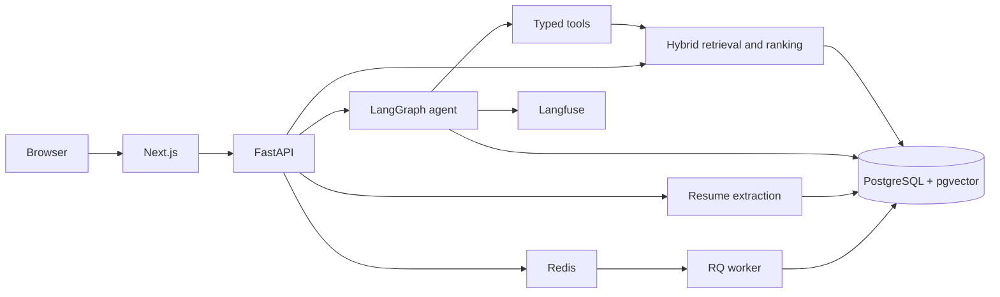
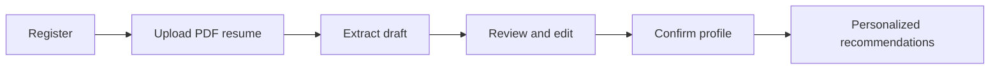
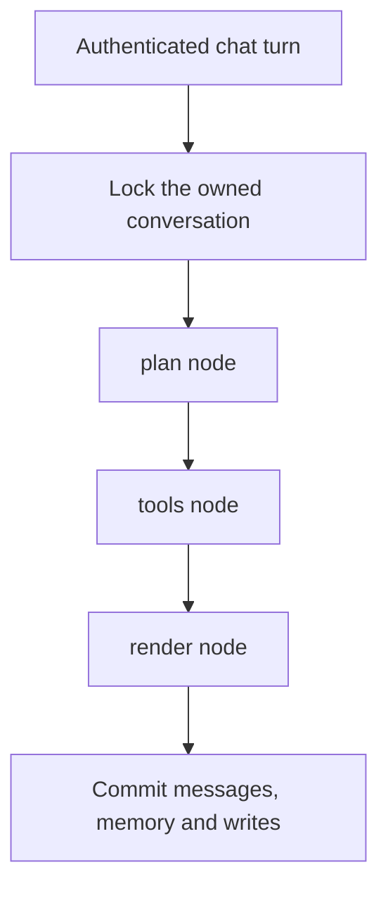
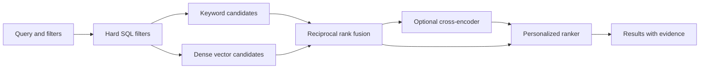

# CareerLens

CareerLens is a job-search workspace for students and early-career engineers. You upload a PDF resume, review the profile extracted from it, search a catalog of real and demo job postings, and talk to a career agent that finds jobs, explains why they match, points out skill gaps, and remembers your preferences.

Every recommendation is **grounded**: it cites a stored job posting and the skills you confirmed on your profile. The agent cannot invent jobs, and it cannot change your data without an explicit request.

## Contents

1. [What it does](#what-it-does)
2. [Tech stack](#tech-stack)
3. [Architecture](#architecture)
4. [Workflows](#workflows)
5. [The career agent](#the-career-agent)
6. [Search and ranking](#search-and-ranking)
7. [Job sources and ingestion](#job-sources-and-ingestion)
8. [Resume extraction](#resume-extraction)
9. [Evaluation](#evaluation)
10. [Observability](#observability)
11. [Security and privacy](#security-and-privacy)
12. [Run locally](#run-locally)
13. [Configuration reference](#configuration-reference)
14. [Deploy](#deploy)
15. [Development and testing](#development-and-testing)
16. [Project layout](#project-layout)
17. [Further documentation](#further-documentation)

## What it does

| Feature | Description |
| --- | --- |
| Accounts | Register and log in with email and password. Passwords use Argon2. Tokens expire after eight hours. |
| Resume upload | Upload a PDF (up to 5 MB and 10 pages) with selectable text. Skills, education, projects, work experience, tools, certifications and domains are extracted into a draft. |
| Profile review | You edit and confirm the draft. Only the confirmed profile is used for matching. The original PDF is not stored. |
| Discover jobs | Browse the full catalog with pagination, or search by keyword, semantic meaning, hybrid, or personalized ranking. Filter by source, location, work setting, employment type, experience, salary and freshness. |
| Recommendations | A dashboard of jobs ranked for your confirmed profile and preferences, with matched and missing skills. |
| Career agent | A chat interface backed by a LangGraph workflow. It searches live and stored jobs, explains matches, analyzes skill gaps, saves jobs, and stores preferences. |
| Saved jobs | Save and remove jobs. Dismissed jobs are excluded from personalized results. |
| Live job search | The agent checks public job feeds (Greenhouse employer boards and Himalayas) at chat time and shows which sources were checked. |
| Evaluations (admin) | A dashboard of recorded evaluation runs, retrieval charts, task completion, and a case review workflow. |
| Observability (admin) | Application readiness and a link to Langfuse traces. |

## Tech stack

| Layer | Technology |
| --- | --- |
| Frontend | Next.js, React, TypeScript |
| API | FastAPI, Pydantic, SQLAlchemy, Alembic |
| Agent | LangGraph with a Postgres-backed conversation state |
| Database | PostgreSQL 17 with pgvector (application database and a separate evaluation database) |
| Queue | Redis and RQ worker. Redis also backs the rate limiter. |
| Embeddings | `local-hash-v1` (built in, no dependencies), MiniLM via sentence-transformers, or Google Gemini via API |
| Chat models | llama.cpp with Qwen 2.5 0.5B (default in Compose), Groq, or OpenAI. Rules-only mode is also available. |
| Observability | Langfuse |
| Evaluation | Custom runner, DeepEval judges (optional) |
| CI | GitHub Actions |

## Architecture



- **Next.js** serves the UI and proxies API calls to FastAPI (`CAREERLENS_API_ORIGIN`, fixed at build time).
- **FastAPI** exposes authentication, profile, resume, job, recommendation, agent and evaluation routes. OpenAPI documentation is at `/docs`.
- **PostgreSQL** holds application state, full-text indexes and pgvector embeddings.
- **Redis and the worker** run queued imports with retries and enforce per-IP rate limits.
- **Evaluation database** is a second Postgres database, so evaluation fixtures never mix with real user data.

### Data model

- **Users** own profiles, extracted skills, preferences, resume drafts, conversations, messages, saved jobs, interactions and feedback. All of it is deleted when the account is deleted.
- **Jobs** belong to a source and carry provenance, an expiration date, a deduplication key and a content hash. Each job has one embedding for the configured model.
- **Conversations** store messages and an agent snapshot (current filters and presented job IDs) in the same transaction.
- **Agent memory** holds saved preferences that apply to new searches.
- **Evaluation** tables hold datasets, runs, per-case results and prompt versions.

The schema has 19 application tables (plus Alembic's version table), with 384-dimension pgvector columns and GIN and HNSW indexes. Tables, relationships, indexes and deletion rules are in [docs/database.md](docs/database.md).

## Workflows

### 1. Onboarding



1. Register an account.
2. Upload a text-based PDF. Extraction runs with local rules or a language model (see [Resume extraction](#resume-extraction)).
3. Review the draft. Edit, add or remove skills and other fields.
4. Choose **Add to profile**. Recommendations refresh from the confirmed profile.

### 2. Searching jobs

1. Open **Discover jobs**.
2. Use **All jobs** to browse with pagination and a source selector (employer postings or demo listings), or **Search jobs** to run a query.
3. Pick a mode: keyword, semantic, hybrid, or personalized.
4. Open a job card to see the details, matched and missing skills, evidence from the posting, and a link to the original posting.
5. Save a job, or give feedback on a recommendation.

### 3. Talking to the agent

1. Ask for something such as "Find live software engineering internships".
2. The agent searches public feeds and the catalog, and shows the jobs with the sources it checked.
3. Refine in the same conversation: "Only show remote roles". Active filters carry over.
4. Ask a follow-up about a result by position: "Why did you recommend the first job?" or "What skills am I missing for the second one?"
5. Store a preference: "Remember that I prefer Python roles". It persists across conversations and API restarts.

### 4. Evaluating (admin)

1. Run an evaluation dataset from the command line.
2. The runner stores a versioned run with metrics and per-case results.
3. Open **Evaluations** to inspect runs, charts and cases. Record a supported, unsupported or abstain verdict on a case.
4. Compare two runs and gate on regressions. Optionally publish a run to Langfuse as an experiment.

### 5. Continuous integration

On every push and pull request GitHub Actions runs lint, migrations, the test suite, the deterministic agent evaluations (failing the build if any turn fails), the retrieval and output benchmarks, and the frontend lint, type check and build.

## The career agent

### How many agents

There is **one agent**: a single LangGraph workflow. It is not a multi-agent system. The workflow has **three nodes** and calls **eleven tools**. Language models play three narrow roles inside it: structured planning, career advice, and (outside the agent) resume extraction. A rules engine can do the planning by itself when no model is configured.

### The graph



| Node | What it does |
| --- | --- |
| `plan` | Turns the user message into up to three typed actions. A local rules router handles common phrases, a curated skills vocabulary and ordinal references such as "the first job". If a model is configured it also plans with structured output validated by a Pydantic schema. If the model fails, the local route is used. General career questions (interviews, resume, portfolio, greetings) go to the model's `career-advice` prompt. |
| `tools` | Validates every action against its tool schema, checks the account, and runs each tool in its own database savepoint, so one failure rolls back alone. Caps a turn at three tools. |
| `render` | Writes the reply from validated tool results and stored job records, not from free model text. Explanations and skill gaps are rendered deterministically. |

The model never sees job descriptions or resume text during planning. It sees the user message, the previous search constraints, how many jobs the user can reference, and the tool names. Job source text is treated as evidence, never as instructions.

### Tools

| Tool | Purpose | Writes data |
| --- | --- | --- |
| `search_live_jobs` | Checks public job feeds, imports eligible postings, and returns ranked results with source status. Can also return an InternDoor search link. | Imports postings |
| `search_jobs` | Hybrid search of the stored catalog. | No |
| `rank_jobs_for_user` | Personalized search using the confirmed profile and preferences. | No |
| `get_user_profile` | Reads the confirmed profile and preferences. | No |
| `update_user_preferences` | Saves preferences for future conversations. Requires an explicit user request. | Yes |
| `get_job_details` | Returns a job by position from the previous results. | No |
| `explain_job_match` | Explains a match using stored evidence. | No |
| `analyze_skill_gap` | Lists matched and missing skills for a job. | No |
| `save_job` | Saves a job. Requires an explicit user request. | Yes |
| `get_saved_jobs` | Lists saved jobs. | No |
| `get_recent_searches` | Shows the last five searches. | No |

### Safety rules

- Identity comes from trusted server context, never from the model.
- The model cannot supply arbitrary job IDs. References resolve to positions from earlier tool results.
- Write tools (`save_job`, `update_user_preferences`) run only on locally recognized, explicit user authorization. Model-planned writes are dropped.
- Each conversation turn is serialized by a row lock, and the filter and job snapshot commits with the messages. After a restart, turns resume from the last committed state.
- Saved preferences apply to new searches until the current request gives different explicit constraints.

### Model providers

| `CAREERLENS_AGENT_MODEL_PROVIDER` | Behavior |
| --- | --- |
| `llama` | Local Qwen 2.5 through llama.cpp (the Compose default). |
| `groq` | Groq, default model `openai/gpt-oss-20b`. |
| `openai` | OpenAI structured outputs. |
| `local` | Rules only, with no model. Used for deterministic evaluations. |
| `inherit` | Use the same provider as `CAREERLENS_LLM_PROVIDER`. |

`CAREERLENS_LLM_PROVIDER` controls resume extraction independently.

## Search and ranking



### Search modes

| Mode | How it works |
| --- | --- |
| Keyword | PostgreSQL full-text search over a weighted document (title, company, description), plus exact matches on the required-skill array. |
| Semantic | Cosine distance over pgvector embeddings. Finds jobs by meaning, so "deep learning researcher" can match a "machine learning engineer" posting with no shared words. |
| Hybrid | Runs keyword and semantic retrieval independently and merges them with reciprocal rank fusion (constant 60). |
| Personalized | Hybrid retrieval followed by the user ranker. Respects confirmed experience and dismissed jobs. |

Hard filters run in SQL before candidate generation: expiration, employment type, work setting, location, company category, experience, known salary and currency, required skills, and freshness. A job with no salary is excluded when a salary filter is set.

For internship queries on machine learning, AI engineering and data science, the engine also checks adjacent role titles and prefers distinct titles over repeats.

### Ranking weights

| Signal | Weight |
| --- | ---: |
| Relevance | 0.35 |
| Required-skill overlap | 0.25 |
| Preference alignment | 0.15 |
| Experience fit | 0.10 |
| Freshness | 0.10 |
| Feedback | 0.05 |

The weights are configurable and hashed into a ranking version that is returned with each result. A match score is a heuristic relevance score. Evidence excerpts, matched skills and missing skills come from the posting and the confirmed profile.

### Embedding models

Embeddings are 384-dimensional. Pick one with `CAREERLENS_EMBEDDING_MODEL`:

| Value | What it is | Memory | Quality |
| --- | --- | --- | --- |
| `local-hash-v1` | Hashed token counts with a few keyword groups. No download and no dependencies. | Minimal | Lexical, limited meaning |
| `sentence-transformers/all-MiniLM-L6-v2` | Neural model run locally. Needs the `embeddings` extra (PyTorch). | 1 to 2 GB | Good |
| `gemini-embedding-001` | Google Gemini API, requested at 384 dimensions. Needs `CAREERLENS_GEMINI_API_KEY`. No local model. | Minimal | Good |

When you change the model, run `python -m app.ingestion reindex`. Embeddings are tagged with the model that made them, and profile vectors regenerate when the model differs. An optional cross-encoder reranker (`CAREERLENS_CROSS_ENCODER`) is off by default because it lowered relevance and raised latency on the bundled benchmark.

### Measured results

From the bundled synthetic benchmark (120 jobs, 105 queries). Relevance grades come from fixture expectations, not human review.

| Strategy | Precision@5 | Recall@10 | NDCG@10 | p95 ms |
| --- | ---: | ---: | ---: | ---: |
| Keyword | 0.478 | 0.474 | 0.545 | 3.8 |
| Neural dense | 0.838 | 0.852 | 0.956 | 16.6 |
| Neural hybrid | 0.848 | 0.858 | 0.965 | 16.9 |
| Neural personalized | 0.878 | 0.879 | 0.998 | 18.7 |

See [docs/benchmarks.md](docs/benchmarks.md) for every strategy, the hash-encoder results and the HTTP benchmark.

## Job sources and ingestion

- **Greenhouse employer boards.** The default configuration imports the public Figma and Duolingo boards on startup. Postings link to their original pages. A posting is marked inactive when it disappears from a successfully fetched board.
- **Himalayas.** Remote opportunities are queried live when the agent searches.
- **InternDoor.** The agent can return a direct search link. It does not scrape the site.
- **Demo listings.** 5,000 labeled synthetic jobs are seeded for local use.
- **JSON Lines import.** Authorized, provenance-tagged feeds can be imported with `python -m app.ingestion import`. The worker retries failed imports and processes bounded batches.

Jobs are deduplicated by source and external ID and by source URL. Content hashes avoid unnecessary embedding writes. Expired postings drop out of search automatically.

## Resume extraction

- Default: local rule-based extraction, so resume text stays on your stack.
- Optional: set `CAREERLENS_LLM_PROVIDER=groq` or `openai` for model-based extraction. The upload screen names the processor. OpenAI requests use `store=False`.
- Uploads are limited by body size, page count and extracted text length. Scanned PDFs without selectable text are not supported.
- Only the extracted draft is stored. Drafts are deleted after seven days if unconfirmed, or on request.

## Evaluation

Evaluation runs against a separate Postgres database seeded with synthetic fixtures. The runner refuses to run if the evaluation database name matches the application database.

### Datasets

| Dataset | Cases | What it checks |
| --- | ---: | --- |
| `agent-single-turn` | 34 | Required and forbidden tools, state changes, grounded job IDs, failure recovery. |
| `agent-multiturn` | 16 | Filter carry-over, follow-up references, preferences across turns. |
| `prompt-injection` | 5 | Hostile instructions do not cause unauthorized state changes. |
| `retrieval` | 105 | Graded relevance per query: Precision@5, Recall@5/10, MRR, NDCG@5/10, latency p50/p95. Empty-result accuracy is tracked separately. |
| `resume-extraction` | 4 | Extracted fields against expected values. |
| `job-explanations` | 5 | Evidence, confirmed skills and completeness. DeepEval can also judge relevancy and faithfulness. |

### Run

```sh
docker compose exec -e CAREERLENS_AGENT_MODEL_PROVIDER=local api python -m app.evaluations.runner agent-single-turn
docker compose exec -e CAREERLENS_AGENT_MODEL_PROVIDER=local api python -m app.evaluations.runner agent-multiturn
docker compose exec -e CAREERLENS_AGENT_MODEL_PROVIDER=local api python -m app.evaluations.runner prompt-injection
docker compose exec api python -m app.evaluations.runner retrieval
docker compose exec api python -m app.evaluations.runner resume-extraction
docker compose exec api python -m app.evaluations.runner job-explanations
```

Each command stores a versioned run. Reports are also written to `evaluation/reports/`.

### Compare and review

```sh
docker compose exec api python -m app.evaluations.runner agent-single-turn --label baseline --output /tmp/baseline.json
docker compose exec api python -m app.evaluations.runner agent-single-turn --label candidate --prompt-label candidate --output /tmp/candidate.json
docker compose exec api python -m app.evaluations.compare /tmp/baseline.json /tmp/candidate.json --tolerance 0.02
```

The compare command exits nonzero when a shared quality metric drops beyond the tolerance. In the **Evaluations** screen, administrators open a case and record a supported, unsupported or abstain verdict with a rationale. The original run metrics are not changed.

### Honest limits

The bundled datasets are synthetic. There is no calibrated human-labeled benchmark. Live model quality, hosted trace delivery and load-test latency need separate verification. Metrics with no denominator are left null, not zero.

## Observability

- **Langfuse tracing** records agent turns, tool calls, retrieval, ranking and model generations. The conversation ID is the session ID and a keyed hash is the user ID. Raw resumes, chat messages and profiles are not exported. Model calls include prompt versions, usage and cost estimates when prices are configured.
- **Prompts** can be managed in Langfuse (`careerlens-<name>`, selected by `CAREERLENS_PROMPT_LABEL`) with a built-in local fallback.
- **Online evaluation.** `CAREERLENS_ONLINE_EVAL_RATE` samples recommendations and queues a source-consistency check that confirms the cited evidence still matches the stored job, without forwarding user text.
- **Health endpoints.** `/health` and `/ready` report liveness and database and queue readiness. The **Observability** screen shows readiness and links to Langfuse.
- **Verify delivery.** Send a chat message, copy `trace_id` from the response, and run:

```sh
docker compose exec api python -m app.evaluations.langfuse_tools smoke TRACE_ID
```

Enable tracing by setting `LANGFUSE_PUBLIC_KEY`, `LANGFUSE_SECRET_KEY` and `LANGFUSE_BASE_URL` (both keys are required). Set `CAREERLENS_TELEMETRY_ENABLED=false` to turn it off. Details: [docs/observability.md](docs/observability.md).

## Security and privacy

- Passwords use Argon2. Tokens expire after eight hours and live in tab-scoped session storage.
- All API routes and tools scope data to the authenticated account. Ownership is verified on every path.
- Admin access requires the address to be in `CAREERLENS_ADMINS` and a provisioned account with an admin flag. Removing an address revokes access.
- Redis rate limits apply to authentication, resume upload and chat.
- A daily `python -m app.manage prune` removes unconfirmed drafts older than seven days and search and conversation history older than 180 days.
- Account deletion cascades through all of a user's data.
- By default resume text and chat messages stay on your stack. If you enable Groq, OpenAI or Gemini, text is sent to that provider.

Details: [docs/security.md](docs/security.md).

## Run locally

Requires Docker with Compose, about 4 GB of Docker memory and several GB of disk. The first start downloads models and job feeds, so it needs network access.

```sh
cp .env.example .env
docker compose up --build -d --wait
```

- App: [localhost:3000](http://localhost:3000). Register an account.
- API docs: [localhost:8000/docs](http://localhost:8000/docs).
- Check database setup: `docker compose logs migrate`.

Compose starts PostgreSQL, Redis, a one-shot `migrate` job (migrations, 5,000 demo jobs, Greenhouse import, indexing, evaluation fixtures), the llama.cpp model server, the API, the worker and the frontend.

### Admin and evaluation dashboard

`create-admin` creates a **new** account. It does not promote an existing one, so use an address that is not yet registered.

```sh
# 1. In .env: CAREERLENS_ADMINS=["you@example.com"]
docker compose up -d api
docker compose exec api python -m app.manage create-admin --email you@example.com
```

### Try the agent

1. Upload a text-based PDF with skills such as Python and PostgreSQL and confirm the profile.
2. Ask **Find live software engineering internships**.
3. Ask **Only show remote roles**, then **Why did you recommend the first job?**.
4. Ask **Remember that I prefer Python roles**. Run `docker compose restart api`, start a new conversation and ask **What are my preferences?**.

### Host development without Docker

```sh
cd backend
uv sync --locked --python 3.12
uv run --locked alembic upgrade head
uv run --locked python -m app.ingestion seed --count 5000
uv run --locked uvicorn app.main:app --reload
# in another shell
uv run --locked python -m app.queueing
# in frontend/
npm ci && npm run dev
```

This needs a pgvector PostgreSQL server and Redis. See [docs/deployment.md](docs/deployment.md).

## Configuration reference

All backend variables use the `CAREERLENS_` prefix. See `.env.example` for a starting file.

| Variable | Purpose |
| --- | --- |
| `CAREERLENS_ENVIRONMENT` | `development`, `production` or `test`. |
| `CAREERLENS_JWT_SECRET` | Token signing secret. Set a unique value in production. |
| `CAREERLENS_ALLOWED_ORIGINS` | JSON list of allowed browser origins. |
| `CAREERLENS_ADMINS` | JSON list of admin emails. |
| `CAREERLENS_DATABASE_URL`, `CAREERLENS_EVALUATION_DATABASE_URL`, `CAREERLENS_REDIS_URL` | Connections. Use the `postgresql+psycopg://` prefix. |
| `CAREERLENS_SEED_COUNT` | Demo jobs to seed. `0` for an empty catalog. |
| `CAREERLENS_GREENHOUSE_BOARDS` | Comma-separated public boards. Empty to disable. |
| `CAREERLENS_AGENT_LIVE_SEARCH`, `CAREERLENS_HIMALAYAS_SEARCH_ENABLED` | Live search toggles. |
| `CAREERLENS_AGENT_MODEL_PROVIDER`, `CAREERLENS_LLM_PROVIDER` | Chat and resume model providers. |
| `CAREERLENS_GROQ_API_KEY`, `CAREERLENS_GROQ_MODEL` | Groq settings. |
| `CAREERLENS_OPENAI_API_KEY`, `CAREERLENS_OPENAI_MODEL` | OpenAI settings. |
| `CAREERLENS_EMBEDDING_MODEL`, `CAREERLENS_GEMINI_API_KEY`, `CAREERLENS_CROSS_ENCODER` | Search embeddings and reranking. |
| `CAREERLENS_RETRIEVAL_MIN_CANDIDATES`, `_OVERSAMPLE`, `_RRF_K`, `CAREERLENS_RERANK_CANDIDATES` | Retrieval tuning. |
| `LANGFUSE_PUBLIC_KEY`, `LANGFUSE_SECRET_KEY`, `LANGFUSE_BASE_URL`, `LANGFUSE_SAMPLE_RATE` | Langfuse tracing. |
| `CAREERLENS_TELEMETRY_ENABLED`, `CAREERLENS_ONLINE_EVAL_RATE`, `CAREERLENS_PROMPT_LABEL` | Telemetry and prompt controls. |
| `CAREERLENS_UV_EXTRAS` | Build-time Python extras. Defaults to `--extra embeddings` in Compose. Leave empty to skip PyTorch. |

## Deploy

Compose is the simplest deployment: one host running the same stack behind an HTTPS reverse proxy. For a split deployment:

| Part | Suggested host |
| --- | --- |
| Frontend | Vercel. Set `CAREERLENS_API_ORIGIN` to the public API URL before the build. |
| API and worker | A Docker host such as Render, Railway or Fly.io. The worker needs a separate background process. |
| PostgreSQL with pgvector | Neon, Supabase or Render Postgres. Create both databases and `CREATE EXTENSION vector`. |
| Redis | Upstash or a managed Redis. |
| Chat model | Groq or OpenAI. The local llama.cpp container is too heavy for small hosts. |
| Embeddings | Gemini, so no PyTorch is needed and the image fits small memory limits. |

Production checklist: `CAREERLENS_ENVIRONMENT=production`, a unique `CAREERLENS_JWT_SECRET`, the exact frontend origin in `CAREERLENS_ALLOWED_ORIGINS`, restricted database credentials with separate roles for the application and evaluation databases, TLS, a release SHA in `CAREERLENS_CODE_COMMIT`, a scheduled `app.manage prune`, and private network access for Redis, PostgreSQL and administrative endpoints. Never commit `.env`.

## Development and testing

```sh
cd backend
uv sync --locked --python 3.12
uv run --locked ruff check .
uv run --locked ruff format --check .
uv run --locked alembic check
uv run --locked pytest -q
uv run --locked python ../scripts/smoke_stack.py --restart-api
```

```sh
cd frontend
npm ci
npm run lint
npm run typecheck
npm run build
```

Point the backend settings at migrated test PostgreSQL and Redis instances and seed fixtures first. To measure HTTP search latency on a running stack:

```sh
cd backend && uv run --locked python ../scripts/benchmark_search_api.py --concurrency 4
```

## Project layout

```
backend/
  app/
    main.py            FastAPI app, middleware, health checks
    agent.py           LangGraph workflow (plan, tools, render) and chat routes
    agent_tools.py     The eleven typed tools
    retrieval.py       Filters, fusion, ranking and match evidence
    embeddings.py      Hash, sentence-transformers and Gemini embeddings
    ingestion.py       Seeding, imports, reindexing
    greenhouse.py      Greenhouse job board import
    live_search.py     Live public-feed search and InternDoor links
    profiles.py        Resume upload, extraction and profile routes
    llm.py             OpenAI, Groq and llama.cpp providers and prompts
    auth.py, jobs.py   Accounts, job routes, recommendations, saved jobs
    observability.py   Langfuse spans
    online.py          Sampled online evaluation checks
    queueing.py        RQ worker
    manage.py          Admin creation and data pruning
    evaluations/       Runner, metrics, comparison, judges, Langfuse tools
  alembic/             Database migrations
  tests/
frontend/              Next.js workspace (dashboard, discover, agent, profile, saved, admin)
evaluation/            Versioned datasets and stored reports
infrastructure/        Database init SQL and monitoring scaffolding
scripts/               Smoke test and search benchmark
docs/                  Detailed guides
.github/workflows/     CI and manual live-model evaluation
docker-compose.yml
```

## Further documentation

- [System architecture](docs/architecture.md)
- [Database schema](docs/database.md)
- [Career agent execution](docs/agent.md)
- [Retrieval, ranking and ingestion](docs/retrieval.md)
- [Evaluation and prompt experiments](docs/evaluation.md)
- [Langfuse observability](docs/observability.md)
- [Authentication, privacy and retention](docs/security.md)
- [Measured benchmarks](docs/benchmarks.md)
- [Development and deployment](docs/deployment.md)
