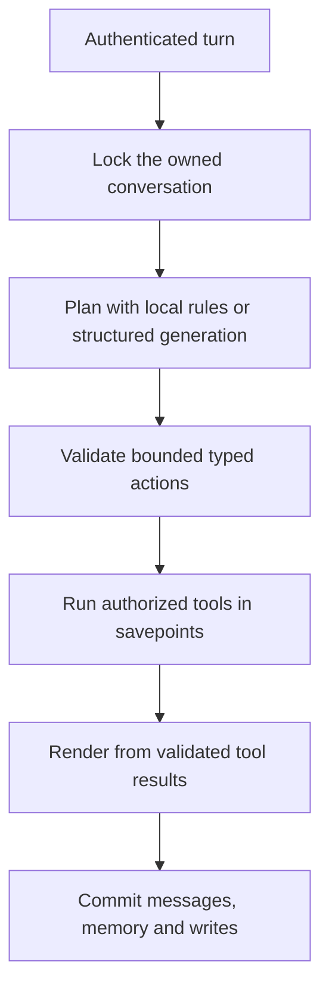

# Career agent

The planner sees the user turn, the preceding search constraints, the number of positions the user can reference, and the tool names. An OpenAI Responses adapter validates its output against a Pydantic schema and retries transient failures within a configured request budget. The local route is available during model failures. Job descriptions and resume documents are excluded from planning context.

The dispatcher validates each action against its tool schema. It verifies the authenticated account, takes identity from trusted runtime context and caps each turn at three tools. Each tool runs in a savepoint, so one failed tool can roll back independently. Write tools require explicit locally recognized user authorization. The model cannot supply arbitrary job IDs. Job references resolve to positions from prior tool results.

The SQL transaction saves the current filter and job state alongside chat history and account changes. The next turn loads that snapshot. This supports process restarts and serializes concurrent turns for a conversation. In-flight turns restart from the last committed state if a process stops. Profile facts enter durable memory through user-reviewed edits. Saved preferences apply to new search sessions until the current request supplies different explicit constraints.

The local agent supports common search and follow-up phrases, a curated skills vocabulary, and ordinal job references. Use job discovery for numeric salary and freshness filters. Match explanations and skill gaps are rendered deterministically using stored evidence.

The adapter uses the official [OpenAI Structured Outputs guide](https://developers.openai.com/api/docs/guides/structured-outputs). The graph uses the documented [LangGraph state and persistence model](https://docs.langchain.com/oss/python/langgraph/persistence).

Compose runs a local Qwen 2.5 model through llama.cpp. The model participates in structured planning and generates answers to general career questions. Explicit tool requests and saved preferences continue to use the existing authorization and grounding checks. Set `CAREERLENS_AGENT_MODEL_PROVIDER=local` to run rules-only evaluations, or `openai` and configure the key for the OpenAI planner. `CAREERLENS_LLM_PROVIDER` controls resume extraction independently. [llama.cpp server API](https://github.com/ggml-org/llama.cpp/tree/master/tools/server)

To use Groq for chat and model-based PDF extraction, set `CAREERLENS_AGENT_MODEL_PROVIDER=groq` and `CAREERLENS_LLM_PROVIDER=groq` and supply `CAREERLENS_GROQ_API_KEY` through the local environment or a deployment secret. The default Groq model is `openai/gpt-oss-20b`. The upload form identifies Groq as the processor. After extraction, **Add to profile** saves the reviewed draft and refreshes related recommendations. [Groq Structured Outputs](https://console.groq.com/docs/structured-outputs)

Career Agent uses `search_live_jobs` for online job discovery. The tool checks configured public feeds, imports eligible published listings, and returns ranked results with source status. Use “search the catalog” to query stored records and “search InternDoor” to get a direct search link. [Live job search sources](retrieval.md#live-job-search-in-chat)
