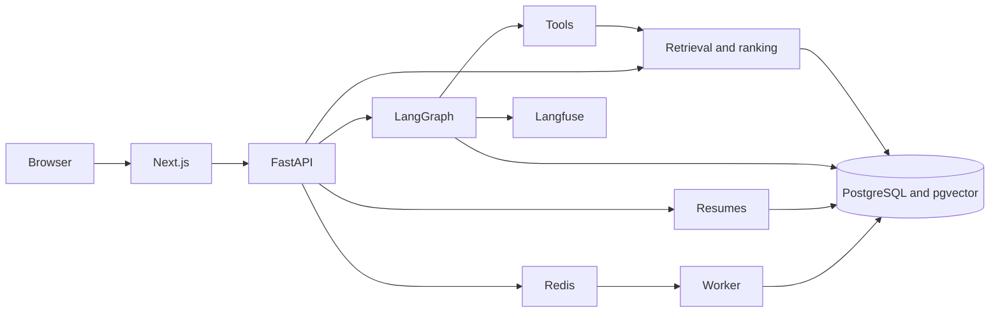

# CareerLens architecture

CareerLens is a modular FastAPI application and a Next.js client. PostgreSQL owns application state and runs both full-text and pgvector queries. Redis backs the worker and API rate limiter. The default local setup uses labeled synthetic jobs and can run without external credentials.

## Persistence

Users own profiles, resume drafts, preferences, conversations, saved jobs, search interactions and ranking feedback. Jobs belong to sources, which also own ingestion runs. Each job has one embedding for the configured deployment model. Evaluation runs own results and record their dataset and experiment configuration. User-owned rows cascade on account deletion. Checkpoint payloads contain job IDs and structured filters keyed by conversation ID. API paths verify ownership before use.

## Agent

State carries the current user message, active filters, previously presented job IDs, typed tool actions, tool outcomes and response. User identity and database handles live in server-side runtime context. The planner sees only the user request and structured search context. Tool execution validates actions, scopes reads and writes to the authenticated user and caps per-turn calls. Grounded rendering uses stored job records and ranking signals. Permanent preference updates require an explicit request.

## Retrieval and ranking

Apply hard filters in SQL before candidate generation. Retrieve keyword and cosine candidates independently, combine with reciprocal rank fusion and optionally score the shortlist with a cross-encoder. Personalized ranking uses configurable weights and supplies matched skills, missing skills, eligibility evidence and the original source. The offline lightweight encoder is reproducible, with a Sentence Transformers backend for neural retrieval.

## Evaluation and telemetry

Agent checks assess executed tools, state changes and grounded job IDs. Retrieval checks consume immutable query judgments and compare production retrieval strategies. DeepEval judges contextual relevance and faithfulness. Keep synthetic expectations and human-reviewed judgments explicitly labeled. Run evaluation against an isolated database. Langfuse receives redacted observations with pseudonymous IDs. Providing the Langfuse project keys enables trace export.

## Delivery sequence

1. Ship the schema, migrations, API foundation, ingestion and reproducible jobs.
2. Add retrieval strategies, filters and configurable ranking.
3. Add authentication, profile and resume confirmation.
4. Run tools through a persistent LangGraph workflow.
5. Trace graph, tools and model calls.
6. Add trajectory, retrieval and output evaluation and compare saved runs.
7. Connect the frontend to the API.
8. Verify the stack and document deployment and monitoring.
