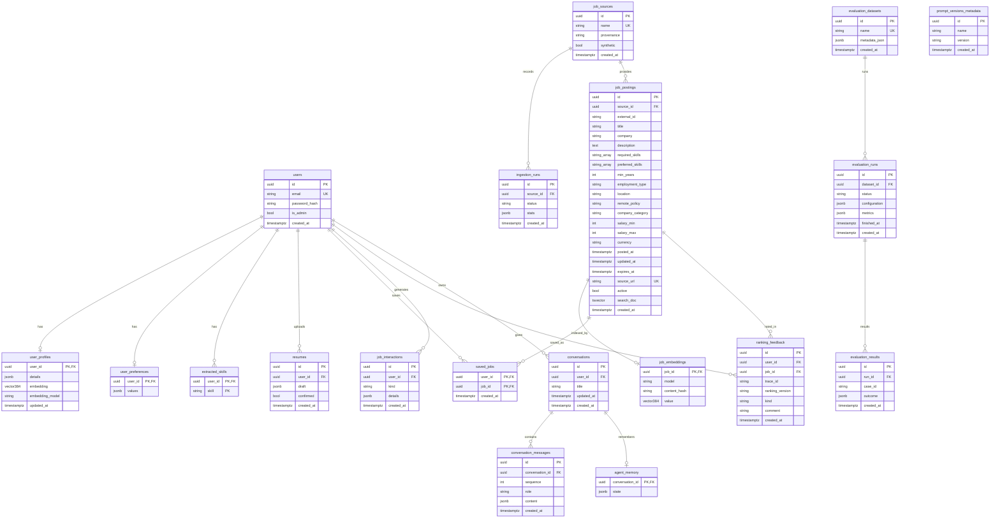

# Database schema

CareerLens uses PostgreSQL 17 with the pgvector extension. The models are defined in [backend/app/models.py](../backend/app/models.py) and the migrations are in [backend/alembic/versions/](../backend/alembic/versions/). The `migrate` service applies them on startup.

There are two databases with the same schema:

- `careerlens` holds application data.
- `careerlens_evaluation` holds synthetic job fixtures, generated accounts and conversations used by evaluation runs. The runner refuses to use it if its name matches the application database.

Inspect the live schema with:

```sh
docker compose exec db psql -U careerlens -d careerlens -c '\dt'
docker compose exec db psql -U careerlens -d careerlens -c '\d job_postings'
```

## Entity relationships



## Accounts and profiles

| Table                | Columns                                                                                                    | Notes                                                                                                  |
| -------------------- | ---------------------------------------------------------------------------------------------------------- | ------------------------------------------------------------------------------------------------------ |
| `users`            | `id` (UUID, PK), `email` (unique), `password_hash`, `is_admin`, `created_at`                     | Passwords are Argon2 hashes.                                                                           |
| `user_profiles`    | `user_id` (PK, FK), `details` (JSONB), `embedding` (vector 384), `embedding_model`, `updated_at` | The confirmed profile. The embedding is regenerated when the active embedding model changes.           |
| `extracted_skills` | `user_id` + `skill` (composite PK)                                                                     | One row per confirmed skill.                                                                           |
| `user_preferences` | `user_id` (PK, FK), `values` (JSONB)                                                                   | Saved search preferences such as work setting and employment type.                                     |
| `resumes`          | `id` (PK), `user_id` (FK), `draft` (JSONB), `confirmed`, `created_at`                            | Extracted drafts only. The original PDF is not stored. Unconfirmed drafts are pruned after seven days. |

## Jobs

| Table              | Columns                                                                                                                                                                                                                                                                                                                                                                                                                  | Notes                                                                                                                                                             |
| ------------------ | ------------------------------------------------------------------------------------------------------------------------------------------------------------------------------------------------------------------------------------------------------------------------------------------------------------------------------------------------------------------------------------------------------------------------ | ----------------------------------------------------------------------------------------------------------------------------------------------------------------- |
| `job_sources`    | `id` (PK), `name` (unique), `provenance`, `synthetic`                                                                                                                                                                                                                                                                                                                                                            | Where a posting came from, for example`greenhouse:figma`.                                                                                                       |
| `ingestion_runs` | `id` (PK), `source_id` (FK), `status`, `stats` (JSONB)                                                                                                                                                                                                                                                                                                                                                           | Counts of indexed, embedded, duplicate and invalid rows.                                                                                                          |
| `job_postings`   | `id` (PK), `source_id` (FK), `external_id`, `title`, `company`, `description`, `required_skills` (text[]), `preferred_skills` (text[]), `min_years`, `employment_type`, `location`, `remote_policy`, `company_category`, `salary_min`, `salary_max`, `currency`, `posted_at`, `updated_at`, `expires_at`, `source_url` (unique), `active`, `search_doc` (generated tsvector) | `(source_id, external_id)` is unique, which deduplicates imports. `search_doc` is a persisted column that weights title (A), company (B) and description (C). |
| `job_embeddings` | `job_id` (PK, FK), `model`, `content_hash`, `value` (vector 384)                                                                                                                                                                                                                                                                                                                                                 | One embedding per job for the configured model. The hash skips unchanged content on reindex.                                                                      |

## User activity

| Table                | Columns                                                                                                  | Notes                                                                               |
| -------------------- | -------------------------------------------------------------------------------------------------------- | ----------------------------------------------------------------------------------- |
| `saved_jobs`       | `user_id` + `job_id` (composite PK), `created_at`                                                  | Jobs the user bookmarked.                                                           |
| `job_interactions` | `id` (PK), `user_id` (FK), `kind`, `details` (JSONB), `created_at`                             | Searches and dismissals.`get_recent_searches` reads the `search` kind.          |
| `ranking_feedback` | `id` (PK), `user_id` (FK), `job_id` (FK), `trace_id`, `ranking_version`, `kind`, `comment` | Feedback on a recommendation, linked to the Langfuse trace and the ranking version. |

## Agent

| Table                     | Columns                                                                            | Notes                                                                                         |
| ------------------------- | ---------------------------------------------------------------------------------- | --------------------------------------------------------------------------------------------- |
| `conversations`         | `id` (PK), `user_id` (FK), `title`, `updated_at`, `created_at`           | One row per chat thread. The turn locks this row.                                             |
| `conversation_messages` | `id` (PK), `conversation_id` (FK), `sequence`, `role`, `content` (JSONB) | `(conversation_id, sequence)` is unique, so message order is fixed.                         |
| `agent_memory`          | `conversation_id` (PK, FK), `state` (JSONB)                                    | The current filters and presented job IDs. Committed in the same transaction as the messages. |

## Evaluation

| Table                        | Columns                                                                                                       | Notes                                                                               |
| ---------------------------- | ------------------------------------------------------------------------------------------------------------- | ----------------------------------------------------------------------------------- |
| `evaluation_datasets`      | `id` (PK), `name` (unique), `metadata_json`                                                             | Versioned dataset names such as`careerlens-retrieval-v1`.                           |
| `evaluation_runs`          | `id` (PK), `dataset_id` (FK), `status`, `configuration` (JSONB), `metrics` (JSONB), `finished_at` | The configuration records the model, prompt label, ranking version and code commit. |
| `evaluation_results`       | `id` (PK), `run_id` (FK), `case_id`, `outcome` (JSONB)                                                | `(run_id, case_id)` is unique. Reviewer verdicts are recorded here.               |
| `prompt_versions_metadata` | `id` (PK), `name`, `version`                                                                            | `(name, version)` is unique. Tracks prompt versions seen in runs.                 |

## Indexes

| Index                                                     | Table and column                        | Purpose                                |
| --------------------------------------------------------- | --------------------------------------- | -------------------------------------- |
| `ix_job_search_doc` (GIN)                               | `job_postings.search_doc`             | Full-text keyword search.              |
| `ix_job_skills` (GIN)                                   | `job_postings.required_skills`        | Exact skill matches and skill filters. |
| `ix_job_active_remote`                                  | `job_postings(active, remote_policy)` | Common catalog filters.                |
| `posted_at` index                                       | `job_postings.posted_at`              | Freshness filters and ordering.        |
| `ix_job_embedding_cosine` (HNSW, `vector_cosine_ops`) | `job_embeddings.value`                | Semantic nearest-neighbor search.      |
| `user_id` indexes                                       | Every user-owned table                  | Ownership lookups.                     |

## Deletion rules

- Every user-owned table references `users.id` with `ON DELETE CASCADE`. Deleting an account removes the profile, skills, preferences, resumes, saved jobs, interactions, feedback and conversations.
- `conversation_messages` and `agent_memory` cascade from `conversations`.
- `job_embeddings`, `saved_jobs` and `ranking_feedback` cascade from `job_postings`.
- `job_postings.source_id` uses `RESTRICT`. A source cannot be deleted while it still has postings.
- `evaluation_runs.dataset_id` uses `RESTRICT`. `evaluation_results` cascade from their run.
- `python -m app.manage prune` removes unconfirmed resume drafts older than seven days and search and conversation history older than 180 days.

## Vector dimensions

Both vector columns, `user_profiles.embedding` and `job_embeddings.value`, are fixed at 384 dimensions. Any embedding model must produce 384 values. `local-hash-v1` and MiniLM do this natively, and Gemini is requested at 384 through `outputDimensionality`. Changing to a different dimension needs a migration and a reindex.

## Migrations

```sh
cd backend
uv run --locked alembic upgrade head     # apply
uv run --locked alembic check            # confirm models match migrations
uv run --locked alembic revision --autogenerate -m "describe change"
```

Applied in this order:

| Revision         | Change                                   |
| ---------------- | ---------------------------------------- |
| `47caeb340bbe` | Initial schema                           |
| `25a4f9693dff` | Add`users.is_admin` for operator roles |
| `8e2b91f45c30` | Make job metadata nullable               |
| `5b596c42651a` | Add the profile embedding model column   |
